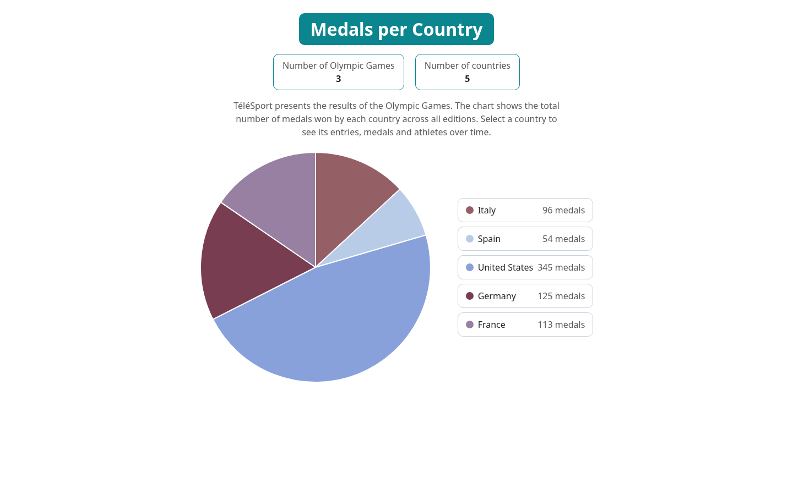
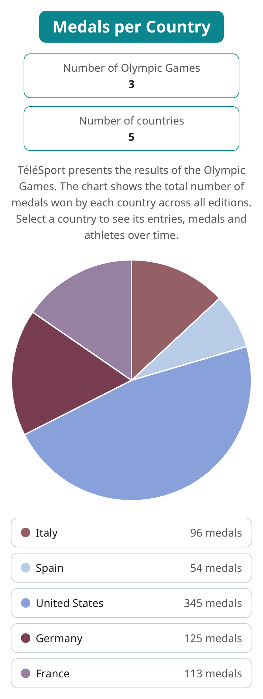
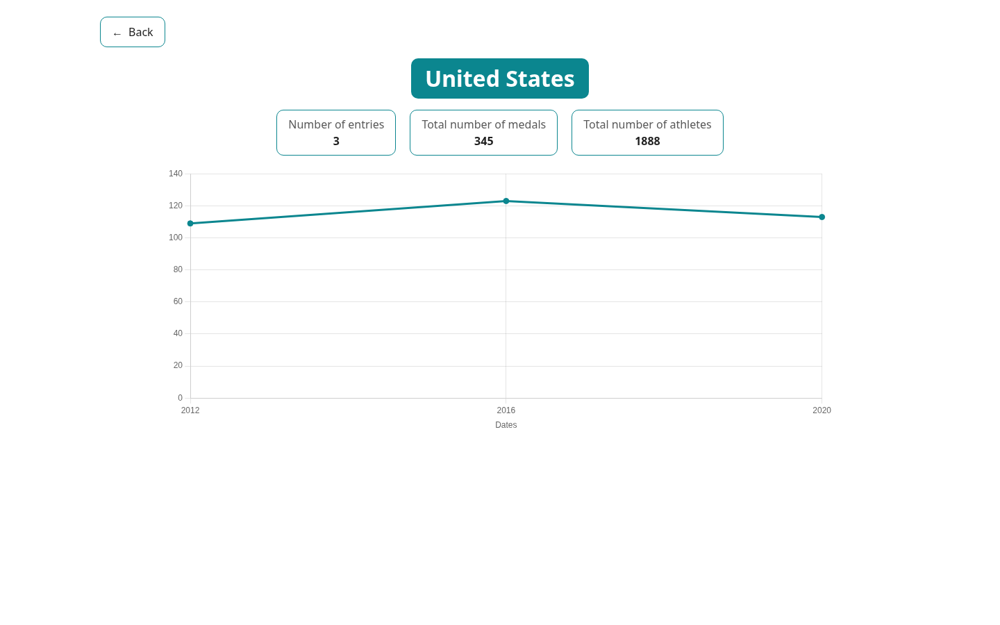
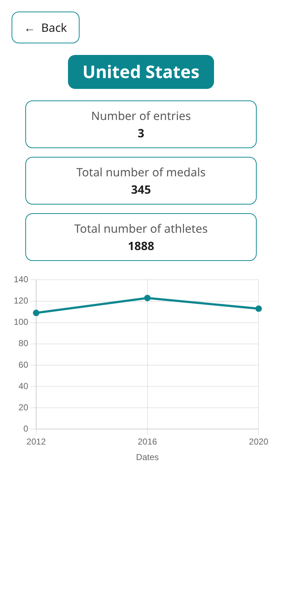

# TéléSport, Jeux Olympiques

Application Angular qui présente les médailles olympiques par pays. Un tableau de bord affiche le total des médailles de chaque pays dans un camembert, et une page de détail montre les résultats d'un pays à chaque édition. Les données sont simulées par un fichier JSON.

L'interface est en anglais, comme les maquettes.

## Sommaire

- [Fonctionnalités](#fonctionnalités)
- [Prérequis](#prérequis)
- [Installation et lancement](#installation-et-lancement)
- [Commandes utiles](#commandes-utiles)
- [Structure du projet](#structure-du-projet)
- [Choix techniques](#choix-techniques)
- [Gestion des erreurs](#gestion-des-erreurs)
- [Responsive et accessibilité](#responsive-et-accessibilité)
- [Tests](#tests)
- [Limites](#limites)
- [Captures d'écran](#captures-décran)

## Fonctionnalités

**Tableau de bord** (`/`)

- Nombre d'éditions des Jeux Olympiques et nombre de pays.
- Camembert du total des médailles par pays, avec une infobulle au survol.
- Un clic sur une part du camembert ou sur un pays de la légende ouvre la page de ce pays.

**Page d'un pays** (`/country/:id`)

- Nombre de participations, total des médailles et total des athlètes.
- Courbe du nombre de médailles à chaque édition.
- Bouton « Back » pour revenir au tableau de bord.

**Page introuvable**

- Un pays inconnu (par exemple `/country/999`) ou une adresse inconnue affiche « Page not found », avec un bouton vers le tableau de bord.

## Prérequis

| Outil | Version |
| --- | --- |
| Node.js | 22 (à partir de 22.22.3), 24 (à partir de 24.15) ou 26 et plus, comme l'exige Angular 22 |
| npm | Celui fourni avec Node.js |
| Angular CLI | 22, facultatif : les commandes `npm` utilisent la version installée dans le projet |

## Installation et lancement

```bash
git clone https://github.com/n-ypy/D-finissez-et-d-veloppez-le-front-end-en-utilisant-du-code-Angular-maintenable.git
cd D-finissez-et-d-veloppez-le-front-end-en-utilisant-du-code-Angular-maintenable
npm install
npm start
```

Ouvrir ensuite http://localhost:4200/. L'application se recharge à chaque modification d'un fichier.

## Commandes utiles

| Commande | Rôle |
| --- | --- |
| `npm start` | Serveur de développement sur http://localhost:4200/ |
| `npm run build` | Build de production dans `dist/telesport/` |
| `npm run watch` | Build de développement, relancé à chaque modification |
| `npm test` | Tests unitaires avec Vitest, relancés à chaque modification |
| `npm test -- --watch=false` | Tests unitaires, une seule fois |

## Structure du projet

```text
src/
├── app/
│   ├── components/       affichage réutilisable : en-tête, graphiques, messages d'état
│   ├── models/           interfaces TypeScript des données
│   ├── pages/            une page par route : tableau de bord, détail d'un pays, page introuvable
│   ├── services/         DataService, seul accès aux données
│   ├── utils/            opérateur RxJS des états d'affichage
│   ├── app.config.ts     routeur et HttpClient
│   ├── app.constants.ts  URL des données, couleurs des graphiques
│   └── app.routes.ts     routes de l'application
├── assets/mock/          données simulées (olympic.json)
├── styles/               points de rupture du responsive
└── styles.scss           styles globaux : couleurs, boutons, focus
docs/                     bannière et captures d'écran
```

Le rôle de chaque composant, le service et le parcours des données sont décrits dans [ARCHITECTURE.md](ARCHITECTURE.md). L'analyse du code de départ se trouve dans [notes-architecture.md](notes-architecture.md).

## Choix techniques

- **Angular 22, composants standalone.** Chaque composant déclare ce qu'il utilise, sans `NgModule`.
- **Un seul service de données.** `DataService` lit le fichier JSON une seule fois et fait tous les calculs. Les pages préparent l'affichage, les composants de `components/` se contentent d'afficher. Pour passer à une vraie API, seul le service changera.
- **Observables lus avec le pipe `async`.** Aucun `subscribe` manuel dans les composants, donc aucun abonnement à détruire à la main. Les graphiques Chart.js sont détruits dans `ngOnDestroy`.
- **Page de détail pilotée par l'URL.** L'identifiant vient de `ActivatedRoute`, la page suit donc l'URL, y compris avec les boutons Précédent et Suivant du navigateur.
- **Chart.js allégé.** Chaque graphique n'enregistre que ce qu'il utilise, au lieu de `chart.js/auto`. Le bundle initial pèse 472 kB, sous le budget de 500 kB.
- **Typage strict.** Les données sont décrites par les interfaces de `models/`, sans aucun `any`.

## Gestion des erreurs

| Situation | Ce que voit l'utilisateur |
| --- | --- |
| Chargement en cours | Un indicateur de chargement |
| Données impossibles à charger ou mal formées | « We couldn't load the data. Please try again later. », avec un bouton « Try again » sur le tableau de bord |
| Aucune donnée | « No data available. » à la place du graphique |
| Pays inconnu ou adresse inconnue | La page « Page not found » |

Aucun message technique n'est affiché. Pour reproduire une erreur : dans les DevTools du navigateur, onglet *Network*, clic droit sur `olympic.json`, puis *Block request URL*.

## Responsive et accessibilité

- Trois mises en page, d'après les spécifications : mobile jusqu'à 767 px, tablette de 768 à 1199 px, desktop à partir de 1200 px.
- Contrastes de niveau AA, contour de focus visible et zones cliquables d'au moins 44 px.
- La légende du camembert est faite de boutons HTML : un pays s'ouvre aussi au clavier.
- Chaque graphique a une description textuelle pour les lecteurs d'écran (`role="img"` et `aria-label`).

## Tests

Les 20 tests unitaires couvrent `DataService` (calculs, cache, nouvel essai après une erreur), l'opérateur `withLoadState`, le composant `StatusMessage` et les états des pages : chargement, erreur, données vides, pays inconnu. Le dessin des graphiques se vérifie dans le navigateur, car l'environnement de test n'a pas de canvas.

## Limites

- Les données viennent d'un fichier JSON local, il n'y a pas encore d'API. Pour en brancher une, seul `DataService` devra changer.
- Le fichier est lu une seule fois. Si les données changent côté serveur, il faut recharger la page pour les voir.
- Le JSON ne donne qu'un total de médailles par édition. La répartition entre or, argent et bronze et le détail par sport ne sont donc pas affichés.
- La maquette écrit le nom des pays autour du camembert. Ici, ils sont dans une légende à côté du graphique, plus lisible sur mobile et utilisable au clavier.
- Il n'y a pas de tests de bout en bout. Le dessin des graphiques et la navigation complète se vérifient à la main dans le navigateur.
- L'interface existe seulement en anglais.

## Captures d'écran

**Tableau de bord, desktop et mobile**

 

**Page d'un pays, desktop et mobile**

 

Les captures en tablette, la page introuvable et l'infobulle du camembert sont dans [docs/screenshots](docs/screenshots).
