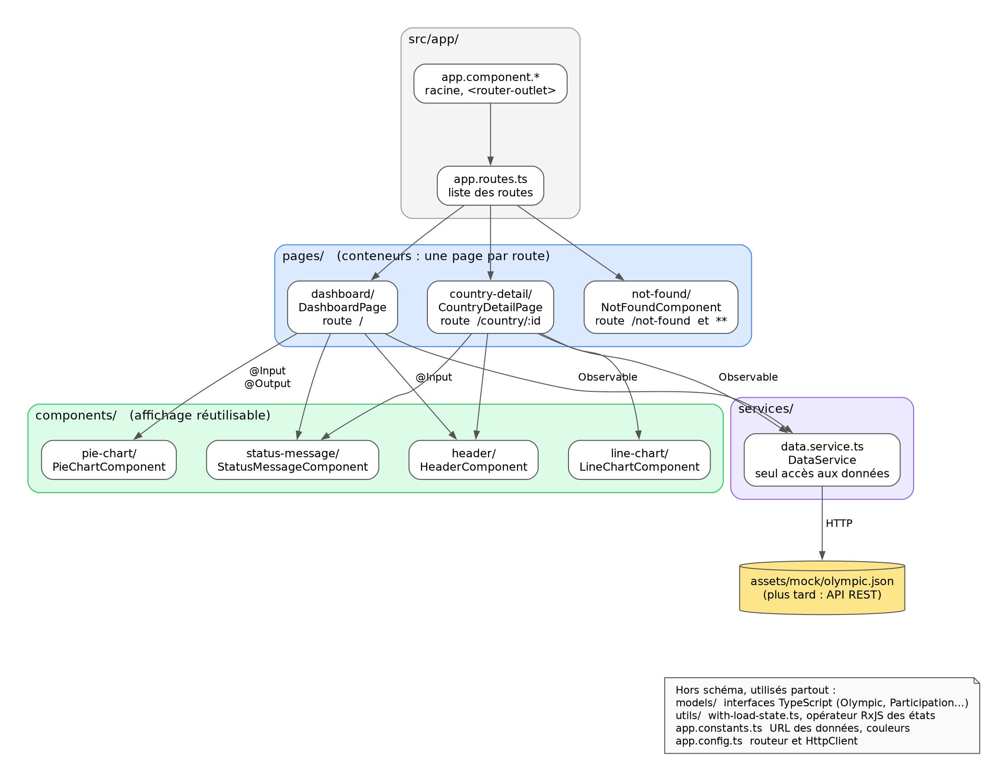

# Notes d'architecture

## Étape 1 : analyse du starter code

Méthode : lecture de `src/app`, `ng serve`, essais dans le navigateur à 1440, 900 et 375 px.
Les fichiers et les lignes cités décrivent le starter avant le refactoring (commit `67c074f`) : `home.component.ts` et `country.component.ts` n'existent plus aujourd'hui.

### 1. Responsabilités mal séparées

- Appels HTTP dans les composants : `home.component.ts:23`, `country.component.ts:29`.
- URL des données dupliquée : `home.component.ts:13`, `country.component.ts:15`.
- Calculs métier dans les composants : `home.component.ts:27-31`, `country.component.ts:34-40`.
- En-tête (titre + indicateurs) dupliqué : `home.component.html:4-18`, `country.component.html:2-20`.
- Tableau de couleurs en dur dans un composant : `home.component.ts:50`.
- Pas de dossiers `services/`, `models/` ni `components/`. Le README décrit un dossier `core/` et un `olympic.service.ts` qui n'existent pas.

> Mon commentaire : les composants font tout : ils récupèrent, calculent et dessinent. C'est le problème principal, et un `DataService` et un `HeaderComponent` en régleraient une grande partie.

### 2. Typage

- `any` dans `home.component.ts` (lignes 23, 27, 28, 30, 31).
- `any` dans `country.component.ts` (lignes 18, 29, 32, 34, 36 à 40).
- Aucune interface pour les données.

> Mon commentaire : avec des `any`, une faute de frappe sur `medalsCount` passe inaperçue à la compilation. Je commencerai par les interfaces, car le reste du refactoring s'appuiera dessus.

### 3. Gestion des observables

- `country.component.ts:28` : le paramètre de route est mis à jour, mais il n'est utilisé qu'une fois, car il n'est pas relié à la requête HTTP.
  Constaté : en revenant de `/country/United States` à `/country/Italy` avec l'historique du navigateur, l'URL change mais le titre reste « United States ».
- `.pipe()` vide : `home.component.ts:23`, `country.component.ts:29`.
- `subscribe(next, error)` est une signature dépréciée par RxJS.

> Mon commentaire : pour le bug de l'historique, un seul flux, de la route jusqu'aux données, l'éviterait.

### 4. Bugs et états non gérés

- Pays inconnu (`/country/Inconnu`) : `TypeError` en console (`country.component.ts:33`), la page affiche des zéros sans message.
- Erreur de chargement (réponse 500) : la page affiche des zéros. `error` est renseigné mais jamais affiché (`home.component.ts:37`, `country.component.ts:45`).
- Données vides : des zéros, sans message.
- Route par nom (`country/:countryName`) alors que la consigne demande `/country/:id` : `/country/1` échoue.
- Graphiques jamais détruits : aucun `ngOnDestroy`.

> Mon commentaire : le plus gênant pour l'utilisateur est de voir des zéros en cas de problème, car il peut les croire exacts.

### 5. Code à nettoyer

- `console.log` : `home.component.ts:25` (affiche tout le JSON), `home.component.ts:36` (affiche `[object Object]`).
- `title = "REMOVE"` : `app.component.ts:12`.
- `{{ pieChart }}` et `{{ lineChart }}` dans les `<canvas>` : `home.component.html:19`, `country.component.html:23`.
- `.map((i) => i)` sans effet : `country.component.ts:34`.
- `<h2>Date</h2>` utilisé comme légende d'axe : `country.component.html:24`.
- Styles de pages globaux dans `styles.scss`, avec une classe `.heading` jamais utilisée.
- `ng test` : 4 tests sur 6 échouent (`app.component.spec.ts`, `country.component.spec.ts`, `not-found.component.spec.ts`).
- `ng lint` n'est pas configuré sur le projet.

> Mon commentaire : rien de grave, mais ces restes gênent la lecture. Je les supprimerai au fil du refactoring.

### 6. Responsive et accessibilité

- Mobile (375 px) : le ratio fixe de 2.5 donne un canvas de 359 × 143 px, soit un camembert d'environ 85 px de diamètre.
- Tableau de bord : aucun élément focusable, les pays ne sont accessibles qu'à la souris.
- `<canvas>` sans `role` ni `aria-label`, et `lang="en"` sur une interface destinée à un public français.
- Contrastes sous le seuil AA de 4.5:1 : blanc sur `#0b868f` (4.36), `gray` sur blanc (3.95).

> Mon commentaire : il n'y a pas de scroll horizontal, mais le camembert est trop petit sur mobile et inutilisable au clavier. Je garde ce point pour l'exercice sur l'interface.

### Points recherchés mais absents

- Fichiers trop volumineux : aucun, le plus long fait 71 lignes. Le problème vient du mélange des responsabilités, pas de la taille.
- Fichiers mal placés : aucun, puisque les dossiers `services/` et `components/` n'existent pas.
- Tableau statique de données : aucun, les données viennent de `src/assets/mock/olympic.json`.

## Étape 2 : nouvelle architecture

### Structure cible

```text
src/app/
├── app.constants.ts        URL des données, couleurs
├── app.config.ts
├── app.routes.ts
├── components/             affichage réutilisable
│   ├── header/             titre + indicateurs
│   ├── line-chart/         courbe
│   └── pie-chart/          camembert
├── models/                 interfaces TypeScript
│   ├── indicator.model.ts
│   ├── olympic.model.ts
│   └── participation.model.ts
├── pages/                  composants liés à une route
│   ├── country-detail/
│   ├── dashboard/
│   └── not-found/
└── services/
    └── data.service.ts     seul accès aux données
```

### Schéma de l'arborescence



Chaque cadre correspond à un dossier de `src/app/`. Les flèches montrent qui utilise qui : le routeur ouvre une page, la page affiche des composants et lit ses données dans `DataService`, qui est le seul à lire le fichier JSON. Le schéma est généré avec Graphviz à partir de [docs/images/architecture.dot](docs/images/architecture.dot) : `dot -Tpng -Gdpi=150 docs/images/architecture.dot -o docs/images/architecture.png`.

### Circulation des données

```text
olympic.json (plus tard : API REST)
        │  HTTP
        ▼
   DataService
        │  Observable
        ▼
DashboardPage / CountryDetailPage
        │  @Input
        ▼
Header / PieChart / LineChart
```

Dans l'autre sens, un clic sur une part du camembert remonte par un `@Output` jusqu'à `DashboardPage`, qui navigue vers `/country/:id`.

### Déplacement des éléments existants

| Aujourd'hui | Demain |
| --- | --- |
| `pages/home/home.component.*` | `pages/dashboard/dashboard.page.*` |
| `pages/country/country.component.*` | `pages/country-detail/country-detail.page.*` |
| Appels HTTP et calculs dans les pages | `services/data.service.ts` |
| URL dupliquée, couleurs en dur | `app.constants.ts` |
| En-tête dupliqué | `components/header/` |
| Code Chart.js dans les pages | `components/pie-chart/`, `components/line-chart/` |
| `any` | `models/` |
| Route `country/:countryName` | Route `country/:id` |
| `pages/not-found/`, `assets/mock/olympic.json` | Inchangés |

### Patterns retenus

- **Singleton** : `DataService` est déclaré en `providedIn: 'root'`. Toute l'application partage la même instance, donc une seule source de données et une seule lecture du JSON.
- **Séparation composant / service** : les composants affichent, le service fournit les données. Chaque élément a un seul rôle et une seule raison de changer.
- **Conteneur / présentation** : les pages récupèrent et préparent les données, les composants de `components/` les reçoivent en `@Input`. Ils restent ainsi réutilisables.
- **Observer** : les pages observent la route et les données avec RxJS. Quand le pays change dans l'URL, tout se recalcule, ce qui corrige le bug de l'historique.

### Préparation au back-end

Toutes les données passent par `DataService`, et ses méthodes de lecture (`getOlympics`, `getOlympicById`) renvoient des `Observable`. Pour brancher une API REST, il suffira de modifier le service : les pages et les composants ne sauront pas que la source a changé.

### Réponse aux problèmes de l'étape 1

| Problème | Réponse |
| --- | --- |
| 1. Responsabilités mal séparées | `DataService`, `HeaderComponent`, composants de graphique |
| 2. Typage | Interfaces dans `models/` |
| 3. Observables | Route et données reliées dans un même flux |
| 4. Bugs et états | Route par `id`, vérification du pays et `ngOnDestroy` dès le refactoring ; messages d'état avec l'interface |
| 5. Code à nettoyer | Supprimé pendant le refactoring |
| 6. Responsive et accessibilité | Traités avec l'interface |
